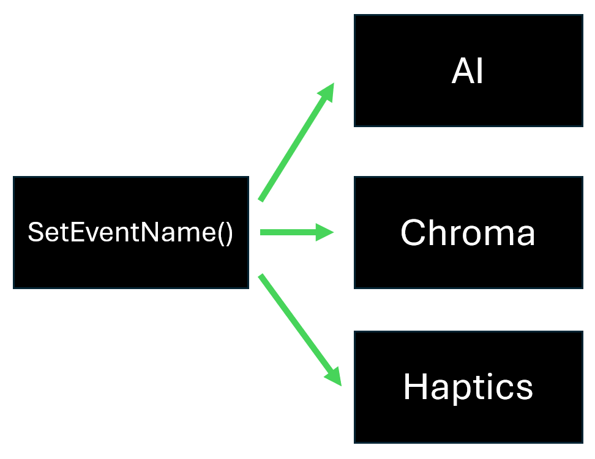

# WYVRN SDK

**Version 2.1.0**. See [CHANGELOG.md](CHANGELOG.md) for the release history.

The `WYVRN SDK` is the all-in-one SDK for all Razer technologies: AI Gaming Tools, Chroma RGB, and Sensa HD Haptics.
The `WYVRN SDK` integration process happens in collaboration with the Razer/WYVRN Team, who designs the Chroma animations, haptic effects, and provides the AI integration. 
Click here to contact us on [Discord](https://discord.gg/HVa96T6BZu). 
*Unlike the Chroma RGB SDK and Interhaptics SDK which can be used independently (without WYVRN team involvement), the WYVRN SDK integration requires working directly with the WYVRN team as everything is hosted on the Razer Synapse side. Game developers don't need to design their own haptic effects or Chroma animations when using the WYVRN SDK - this is handled by the WYVRN team.

**What WYVRN offers:**
- Chroma RGB integration and design
- Sensa HD Haptics integration and design
- AI integration

## Overview

The `WYVRN SDK` allows developers to name events for game state, player state, abiltities, actions, and environments. The external WYVRN configuration controls AI, Chroma, and haptics.

The WYVRN SDK is the combination of AI, Chroma, and Razer Sensa HD Haptics in a single SDK. By integrating AI, RGB lighting and haptics into game environments and events, players can enjoy a truly immersive gaming experience. The `WYVRN SDK` is capable of playing Chroma animations and haptics on the Razer Sensa HD Haptics devices. `SetEventName()` can trigger AI interaction, RGB lighting, or haptics or all of the above.



## Downloads

**SDKs**

* **WYVRN SDK**

|| Engine | Git Repo | Download Link | Git Repo | Download Link | Git Repo | Download Link |
|----------|----------|---------|---------------|---------|---------------|---------|---------------|
| **Encoding** | |  UNICODE |  | ASCII | | MULTI-BYTE | |
|| WYVRN Design Template    | [Git](https://github.com/WyvrnOfficial/CSDK_WyvrnSDK_GameSample/releases/tag/2.0.1.6)   | [Download](https://github.com/WyvrnOfficial/CSDK_WyvrnSDK_GameSample/releases/download/2.0.1.6/Wyvrn_Design_Template_Developers.xlsx)   | ||||
|| WYVRN C++ SDK  | [Git](https://github.com/WyvrnOfficial/CSDK_WyvrnSDK_GameSample/tree/UNICODE_WITHOUT_DLL)   | [Download](https://github.com/WyvrnOfficial/CSDK_WyvrnSDK_GameSample/archive/refs/heads/UNICODE_WITHOUT_DLL.zip) | [Git](https://github.com/WyvrnOfficial/CSDK_WyvrnSDK_GameSample/tree/ASCII_WITHOUT_DLL)   | [Download](https://github.com/WyvrnOfficial/CSDK_WyvrnSDK_GameSample/archive/refs/heads/ASCII_WITHOUT_DLL.zip) | [Git](https://github.com/WyvrnOfficial/CSDK_WyvrnSDK_GameSample/tree/MULTIBYTE_WITHOUT_DLL)   | [Download](https://github.com/WyvrnOfficial/CSDK_WyvrnSDK_GameSample/archive/refs/heads/MULTIBYTE_WITHOUT_DLL.zip) |
|| WYVRN Unreal SDK    | [Git](https://github.com/WyvrnOfficial/Unreal_WyvrnSDK/tree/UNICODE_WITHOUT_DLL)   | [Download](https://github.com/WyvrnOfficial/Unreal_WyvrnSDK/archive/refs/heads/UNICODE_WITHOUT_DLL.zip)   |
|| WYVRN Unity SDK    | [Git](https://github.com/WyvrnOfficial/Unity_WyvrnSDK/tree/UNICODE_WITHOUT_DLL)   | [Download](https://github.com/WyvrnOfficial/Unity_WyvrnSDK/archive/refs/heads/UNICODE_WITHOUT_DLL.zip)   |

## PlayStation 5 — Sensa HD Haptics on the DualSense

On PS5 there is no Synapse and no `RzChromatic` DLL, so `SetEventName()` cannot be
routed to a host service. Instead the SDK carries the haptics itself: WYVRN events
are mapped to the **Interhaptics HAR** runtime and rendered on the DualSense,
including its **adaptive triggers**. The Windows/Xbox path is untouched.

Three pieces make this work:

1. **Editor-time import.** A WYVRN haptic folder (`WYVRN.config` plus its `.haps`
   files) is pulled into the project and baked into assets.
2. **Automatic event mapping.** At runtime the baked table maps each
   `External_Command_ID` onto HAR material playback, honouring the config's
   `Priority`, `Mixing`, `Targeting`/`Spatialization`, `Loop` and
   `Interrupts_Commands`.
3. **Adaptive triggers.** An effect whose `.haps` carries a **Stiffness** track
   drives L2/R2 resistance on the triggers its `Hand` sides address.

### Setup

This repository is a **UPM package**, not a Unity project, so it is consumed by a
project rather than opened directly: add it through *Window → Package Manager → Add
package from disk*, or reference it in your `Packages/manifest.json`:

```json
"com.razer.wyvrnsdk": "file:../path/to/Unity_WyvrnSDK"
```

**1. Drop in the Interhaptics libraries.** Copy `HAR.prx` and
`Provider_DualSensePS5.prx` out of the Interhaptics Engine SDK for PS5 into
`Assets/Plugins/PS5/` in your game project, together with the `.prx.meta` next to
each one (not the `.a` files). The `.prx.meta` files enable each library for PS5 only;
if your copy has none, select each `.prx`, tick only **PS5** under *Platform
settings* in the Inspector and click **Apply**. Commit the `.prx.meta` files with
your project so the setting is kept. Don't put the libraries inside this package:
a Git-URL install lives in `Library/PackageCache`, which Unity rebuilds, so they
would be lost. Use the `SDK<version>` folder matching your Unity PS5 module, and
mind the `lib` prefix on SDK 7–9 vintages. These binaries are
licensed separately and are not part of this repository — see
[Plugins/PS5/README.md](Plugins/PS5/README.md). Without them the SDK stays inert on
PS5: the title still builds, boots and plays, just silently.

**2. Point the importer at your haptic folder.** *Project Settings → WYVRN →
Haptics Import*. The default root is Synapse's install location
(`C:/Program Files (x86)/Interhaptics/hapticFolders`) and the app folder defaults to
the Unity product name.

**3. Import.** *Tools → WYVRN → Import WYVRN Haptics…*, confirm the folder, and the
baked assets are written under `Assets/Resources/Wyvrn/`.

> The output has to live in a **Resources** folder. Nothing in the project
> references the baked data — the runtime loads it by path — so anywhere else it
> would be stripped from the player build and no events would play. The importer
> refuses to run if the configured root is not a Resources folder.

**Step 3 is not optional, and skipping it is invisible.** Without it a PS5 build
still succeeds, still boots, and still brings HAR up — it just drops every event,
because the command table it looks up was never put in the player. A PS5 build logs
a warning when the baked data is missing, so check the build log if the pad stays
quiet.

For build pipelines, the same import runs headless:

```
Unity.exe -batchmode -quit -projectPath <project> \
  -executeMethod WyvrnSDK.Haptics.EditorTools.WyvrnHapticsImportMenu.ImportFromCommandLine \
  -wyvrnHapticFolder "C:/Program Files (x86)/Interhaptics/hapticFolders/My Game"
```

### Using it

Nothing changes in game code — `CoreInitSDK` / `CoreSetEventName` / `CoreUnInit`
work as they do on Windows:

```csharp
WyvrnSDK.APPINFOTYPE appInfo = new WyvrnSDK.APPINFOTYPE();
appInfo.Title = "My Game";
WyvrnAPI.CoreInitSDK(ref appInfo);

WyvrnAPI.CoreSetEventName("Effect1");   // plays its haptics on the DualSense
```

`WyvrnAPI.IsInitialized()` reports whether the haptics are actually live, which is
`false` when the Interhaptics libraries are missing even though `CoreInitSDK`
succeeded.

### Player-facing controls

Three independent settings, for a game's own audio/haptics options menu. All may be
called before `CoreInitSDK` and survive an init/uninit cycle. Each returns
`RZRESULT_SUCCESS` on PS5 and `RZRESULT_NOT_SUPPORTED` elsewhere, so a shared
settings screen can call them unconditionally.

| Call | Effect |
|------|--------|
| `SetHapticsEnabled(bool)` / `GetHapticsEnabled(out bool)` | Master switch. Off stops playback, releases both triggers, and skips further events. |
| `SetVibrationGain(int)` / `GetVibrationGain(out int)` | Vibration strength 0–100 (clamped). **Vibration only** — it never scales trigger resistance, and a gain of 0 still plays events, because one may need to arm a trigger. |
| `SetAdaptiveTriggersEnabled(bool)` / `GetAdaptiveTriggersEnabled(out bool)` | Trigger resistance on/off, independent of vibration. Off releases what is armed but leaves events playing. |

### Behaviour notes

- **Priority ducking.** The highest-priority event playing silences every
  lower-priority one for its duration. A ducked event keeps playing (muted), so its
  timeline advances and it resumes mid-stream when the dominant event ends.
- **Mixing.** Equal-priority events `Merge` by default; an `Override` event plays
  alone and silences older equal-priority ones until it ends.
- **Polyphony.** Each effect is loaded under several HAR material ids, so the same
  effect can overlap itself. Re-triggering a *looping* event restarts its own voice
  instead of stacking another infinite loop.
- **Adaptive triggers latch.** Arming a trigger has no duration — the stiffness
  envelope maps trigger *travel*, not time — so it is **not** released when playback
  ends. Only an authored OFF command (`Interrupts_Commands`), a stop-all, or the
  master switch releases it. Design an explicit OFF event for every stiffness event.
- **Laterality.** `Spatialization` `Global` addresses both palms and both triggers;
  `Left`/`Right` addresses one. Only the `Hand` target region reaches the DualSense;
  other body regions in the config are ignored on PS5 (`All` is treated as `Hand`).
- **Threading.** HAR synthesis runs on a dedicated worker thread; the main thread
  only enqueues event names.

### Debugging

- `WyvrnSDK.Haptics.WyvrnHapticsLog.VerboseEnabled = true` traces each event through
  every stage: `CoreSetEventName` → backend → worker queue → command lookup → voice.
- `Tests/GameSampleHapticsDebug.cs` is a guided walkthrough of the `Debug_*` commands
  in the sample `WYVRN.config`: 30 steps covering laterality, interrupts, priority
  ducking, Merge vs Override, the adaptive-trigger latch and the three controls, each
  naming what it fires and what it should feel like. Any gamepad button advances a
  step, so it is usable on a devkit, where there is no pointer to click with.

  To use it, run **Assets → Razer Wyvrn SDK - Setup Sample Scenes** to copy
  `Scene_GameSample` into your project's `Assets/Scenes`, then add
  `GameSampleHapticsDebug` to the `GameSample` object in *that* copy. Add it to the
  copy rather than to the one inside the package: the packaged scene predates Unity
  2021, and saving it from a current editor rewrites it into a format older editors
  cannot open, which would break the 2021.3 support this package declares.

  The harness reads the gamepad through the legacy Input Manager, so *Project
  Settings → Player → Active Input Handling* must be "Input Manager (Old)" or "Both".
  Under "Input System Package (New)" it still compiles but falls back to its
  pointer-driven buttons.
- The render worker registers itself with the profiler, so it appears as its own
  **WYVRN → Haptic Renderer** thread with `Wyvrn.Haptics.RenderLoop` and
  `Wyvrn.Haptics.HARRender` samples — that is where to look if HAR synthesis starts
  costing frame time.

## Latest

See [https://wyvrn.com](https://wyvrn.com) and [https://doc.wyvrn.com](https://doc.wyvrn.com) for the latest updates and documentation about the WYVRN SDK.
